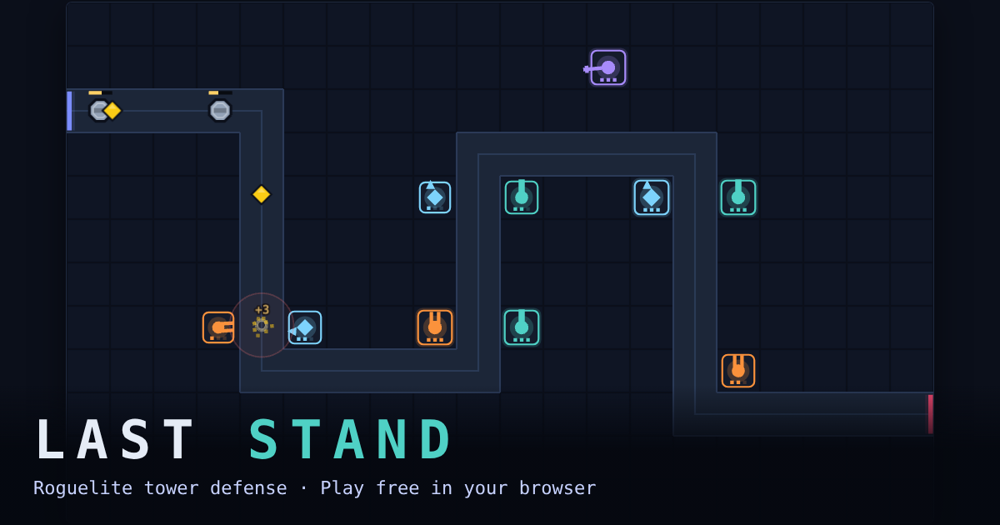

# Last Stand

**[Play it in your browser →](https://fchatur.github.io/FChatur/)** (free, no install, no account)

A roguelite tower defense game. Build towers along the path, pick run upgrades every five waves, and
see how long you can hold the line. Runs take 10–30 minutes; your best wave is saved.



Built with TypeScript, Phaser 3 and Vite. No backend; everything runs in the browser.

**Status:** MVP complete (Phases 1–5). See [docs/PLAN.md](docs/PLAN.md) for the roadmap and long-term
direction, and [CHANGELOG.md](CHANGELOG.md) for every release. Each release is tagged `last-stand-vX.Y.Z`.

**Browsers:** desktop Chrome, Edge, Firefox and Safari (2022 releases or newer), mouse and keyboard.
Tested automatically in Chromium, Firefox and WebKit on every change. Mobile/touch is on the roadmap.

## How to play

| Action | Mouse | Keyboard |
| --- | --- | --- |
| Build a tower | Drag its card from the left shop onto a free tile | |
| Pick a tower to build | Click its card in the left shop | `1` Archer, `2` Ballista, `3` Ranger, `4` Frost Mage |
| Build the picked tower | Click a free tile | |
| Collapse / expand the shop | Arrow button at the top of the shop | |
| Select a built tower | Click it | |
| Upgrade selected tower (3 levels) | Upgrade button | `U` |
| Sell selected tower (70% refund) | Sell button | `S` |
| Targeting (First, Last, Strongest, Fastest) | Buttons in the tower panel | `T` cycles |
| Cancel / deselect | Right-click | `Esc` |
| Game speed 1x / 2x / 3x | Speed buttons | `F` cycles |
| Pick a run upgrade (every 5th wave) | Click a card | `1` `2` `3` |
| Start next wave (skips the countdown) | Start Wave button | `Space` |
| Auto Wave on/off (next wave starts 3s after the last) | Auto button | `A` |
| Pause / resume | Pause button | `P` or `Esc` |
| Mute sound | Speaker button (top right) | `M` |
| Restart after game over | Play again | `R` |

**Towers** (each manned by a hero who grows with its three upgrade levels): Archer, Wren (balanced),
Ballista, Brakk the dwarf engineer (global range: hits the toughest enemy anywhere on the map, slow but
heavy), Ranger, Fen the elf (fast weak shots, poor against armor), Frost Mage, Old Rime (slows what he hits).

**Run upgrades:** after every 5th wave you pick 1 of 3 random upgrades that last for the rest of the run.
Upgrades have rarities (Common, Uncommon, Rare, Legendary), stack up to a limit, and some only appear once
you've built a matching tower. Current pool: Overclock, Critical Strike, Compound Interest, Frostbite,
Explosive Rounds, Chain Lightning. New upgrades are added as data in `src/config/upgrades.ts`.
They combine: Frost Mage + Frostbite + Ranger shreds slowed enemies, Ballista + Critical Strike handles bosses.

**Enemies:** Goblin, Wolf (fast, from wave 3), Armored Orc (from wave 5), Ogre Warlord boss (every 10th wave). Armor removes a flat amount from every hit, so prefer big hits against Orcs and bosses.

Hover a tower (in the shop or on the board) for its stats, special mechanics and active bonuses, and to see its range. Enemies that reach the red exit cost health (bosses cost much more); the run ends at 0.

## Run locally

Requires Node.js 20 or newer.

```bash
cd last-stand
npm ci          # install exact locked dependencies
npm run dev     # start dev server at http://localhost:5173
```

Other scripts:

```bash
npm test          # unit, fuzz and model tests (Vitest, ~7 s)
npm run test:slow # wave-100 soak test on a maxed-out board (~30 s)
npm run test:e2e  # production build + end-to-end browser tests (Playwright, Chromium by default)
npm run typecheck # TypeScript only
npm run build     # typecheck + production build into dist/
npm run preview   # serve the production build at http://localhost:4173
npm run balance   # bots play every map with several strategies; prints a waves-survived report
```

`npm run test:e2e` needs Playwright's browsers once: `npx playwright install chromium` (or
`firefox`/`webkit`; choose with `E2E_BROWSERS=chromium,firefox,webkit`).

In the dev server (`npm run dev`) only, `window.__lastStand` exposes the session and Phaser game for
debugging and automated playtests; it is stripped from production builds.

## Deploy

The build is a static folder (`dist/`) with relative asset paths, so it works from any URL path.

### GitHub Pages (automatic)

The workflow at `.github/workflows/last-stand.yml` runs on every push that touches `last-stand/`: unit
and soak tests, the production build, and the end-to-end tests in Chromium, Firefox and WebKit. On
`main`, once all of those pass, it deploys to GitHub Pages and tags each new version as
`last-stand-vX.Y.Z` (taken from `package.json`).

The link-preview image and URL in `index.html` (`og:image`, `og:url`) point at the GitHub Pages address;
update them if the game moves.

One-time setup: in the repository on GitHub, go to **Settings → Pages → Build and deployment → Source** and choose **GitHub Actions**. After the next push to `main` the game is live at `https://<user>.github.io/<repo>/`.

### Cloudflare Pages

Create a Pages project connected to the repository with:

- Root directory: `last-stand`
- Build command: `npm ci && npm run build`
- Build output directory: `dist`

### Anywhere else

Run `npm run build` and upload the contents of `dist/` to any static host.

## Project layout

```
src/config   Tunable game data: towers, enemies, upgrades, global balance, maps (with per-map modifiers)
src/core     Simulation and rules (no Phaser, unit-tested)
src/game     GameSession: glue between simulation, scene and UI
src/balance  Headless balance harness (not part of the game bundle)
src/render   Phaser drawing (baked static art, entities, effects, viewport sizing)
src/scenes   Phaser scene: game loop and board input
src/audio    Procedural sound effects (Web Audio, no files)
src/ui       HTML HUD, tooltips, tutorial, notices, keyboard shortcuts
tests        Vitest tests (unit, fuzz, soak)
e2e          Playwright end-to-end tests
public       Static files copied as-is (link-preview image)
```

All gameplay numbers live in `src/config`. Change a value there, and the game and tests pick it up.
