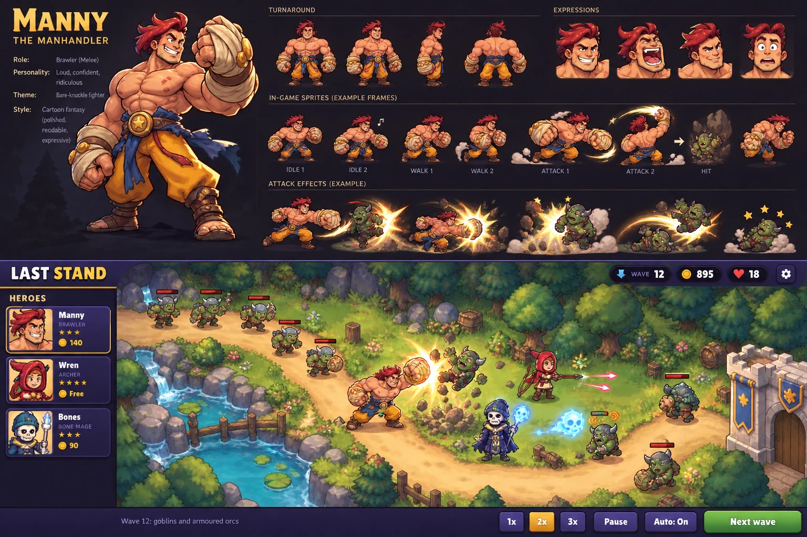

# Style reference v1 (v0.8.0 art direction)

`reference/concept-sheet-v1.webp` is the owner's concept sheet. It was made with OpenAI's image
generation (its C2PA record names the OpenAI Media Service) and is the **visual reference** for v0.8.0.
It is a composite concept, not production art: nothing is cropped from it for use in the game.

## 1. What makes it work

| Layer | What the sheet does |
| --- | --- |
| **Characters** | Exaggerated "heroic cartoon" proportions: a big upper body, huge hands, short legs, a head about a fifth of the height. Painted cel shading: two or three tones per material with soft gradients, warm highlights, muscle and cloth detail. A dark plum-brown outline (about `#251a24`, close to the game's ink `#2b1a22`), thicker on the silhouette than inside. Faces are big and readable. |
| **Manny** | Spiky crimson hair swept back, a square jaw, a cocky grin. Shirtless with a very broad chest and shoulders. Gigantic bandaged fists with gold knuckle rings and leather bracers. A blue sash with a gold star-medallion belt, baggy orange-gold trousers, leather leg wraps and sandals. Silhouette: hair spikes, two oversized fists, a wide stance. |
| **Environment** | Dense and layered: a dirt road with worn edges, cliffs and boulders, a waterfall and stream, fences, barrels, crates, varied foliage and flowers. Warm afternoon light from the upper left with soft shadows. The view looks down at about 60–70°, so props show their fronts. |
| **Effects** | Additive gold-white impact bursts, flying rock debris, dust clouds, stars, coloured projectile trails (pink arrows, blue spectral skulls). The effects are the brightest things on screen. |
| **Interface** | The existing prototype layout, with illustrated portraits, richer bevels, gold trim and chunky rounded type. |
| **Palette** | Manny: skin `#e99968` / `#c97653` / `#b05837` / `#8e442a`, trousers `#e38822` / `#f8c75c`, sash `#383d5f`, wraps `#f9e9b1` / `#ebb886`, outline `#251a24`. Ground: greens `#828c3e` / `#b1ab47` / `#606139`, road `#f1bd6f`, water `#32849f` / `#58a9c7`, stone `#5c5b6a`. |

## 2. Compared with the gameplay-screen prototype

| | Prototype (code-drawn) | Reference | Gap |
| --- | --- | --- | --- |
| Characters | Flat vector cartoon, one shade per material, thin details | Painted, textured, dramatic proportions and faces | Large: needs illustrated sprites |
| Environment | A flat meadow, round trees, a simple road | Layered terrain, water, cliffs, props, lighting and depth | Large: needs illustrated maps |
| Effects | The same ideas (POW, launch, dust, stars), flat colours | Glowing additive light, debris, richer colour | Medium: generated effect frames plus additive blending |
| Interface | Same layout and colours | Same layout, illustrated portraits, more polish | Small |
| Motion | Lively: anticipation, hit-stop, knockback, quips | A still image | The prototype's motion system carries over |

The sheet's layout, interface and moments are the prototype's, so the structure, interface code and
motion design are kept. What changes is the art filling them.

## 3. How each layer reaches this quality

- **Characters:** illustrated key frames generated from a locked design, then processed in code:
  - background removal;
  - one scale per character;
  - feet anchoring;
  - colour grading toward the character's palette.

  They're animated with key-frame swaps plus code motion (squash, lunge, hit-stop, launch). Manny comes
  first; see [MANNY_ASSETS.md](MANNY_ASSETS.md).
- **Environment:** one painted background per map, generated from a layout guide I render from the
  map's real road data, so the painted road matches the road enemies walk.
  - I check the alignment by overlaying the route.
  - I derive the blocked areas for free placement from the image.
  - Tall props near the road (trees, fences) become separate sprites only where characters must pass
    behind them.
- **Effects:** generated effect frames on a pure black background, drawn with additive blending (black
  disappears, so no keying is needed), plus code particles for debris, dust and stars, as now.
- **Interface:** the existing interface code, with illustrated portraits from each hero's expression
  frames.
- **Finish:** in-engine soft shadows, a light warm colour grade and a vignette, ambient particles (leaves,
  fireflies) and animated water highlights.

## 4. Risks and how they're handled

- **Consistency between frames.** The sheet itself shows the problem:
  - Manny's fist size and proportions change between its example frames;
  - Attack 2 turns him round;
  - the "Hit" frame isn't Manny.

  Mitigations:
  - one master image;
  - poses generated as strips in one image, which keeps them closer;
  - a written design lock in every prompt;
  - per-frame checks against a checklist, with re-rolls;
  - processing to equalise scale and colour.
- **Detail at gameplay size.** At ~128 px tall, painted detail turns to mush unless shapes are bold.
  Source frames are exported at twice gameplay size and checked at real size before acceptance.
- **Bones.** The sheet's Bones (a hooded dark-blue robe, a spectral skull projectile) differs from the
  earlier Bones concept (cardigan and beanie). Which one to keep is decided when Bones is up; Manny
  comes first.
